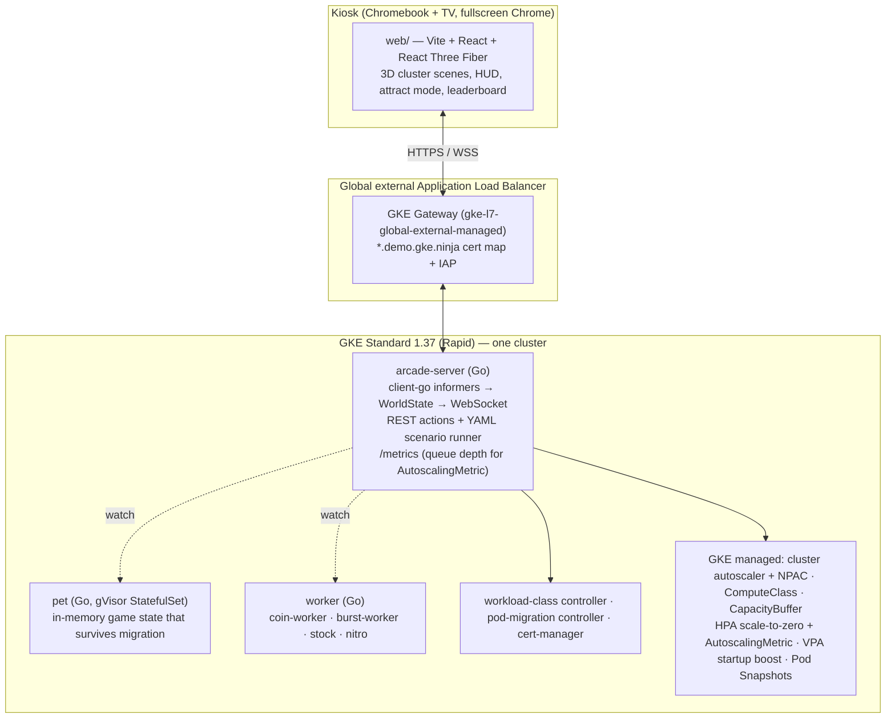

# 🕹️ Autoscale Arcade

**The latest and greatest in GKE cluster and workload autoscaling — as an arcade.**

Autoscale Arcade is an interactive, WebGL-powered kiosk demo built for **KubeCon + CloudNativeCon North America 2026 (Salt Lake City)**. It runs on a single **GKE Standard 1.37** cluster and turns six autoscaling features into six playable "cabinets". Every animation on screen is driven by real Kubernetes objects streamed live from the cluster; nothing is faked.

| Cabinet | GKE feature | What you do |
| :--- | :--- | :--- |
| **Capacity Climber** | [Custom Compute Classes](https://docs.cloud.google.com/kubernetes-engine/docs/concepts/about-custom-compute-classes) + node pool auto-creation + active migration | Climb the obtainability ladder: Spot first, fall back, migrate back. |
| **Spot On** | [Workload Class](https://github.com/gke-labs/workload-class) Spot placement with the **On-Demand / Spot ratio** | Dial the Spot mix, survive a preemption, watch active reversion. |
| **Pod Teleporter** | [Live Pod Migration](https://github.com/gke-labs/pod-migration) on GKE Pod Snapshots + gVisor | **Drag a running pod to another node.** Its memory comes with it. |
| **Shock Absorber** | [Capacity Buffers](https://docs.cloud.google.com/kubernetes-engine/docs/concepts/capacity-buffer) (active + standby) | Pick a buffer, fire a burst, beat the clock at the lowest cost. |
| **Lights Out** | [Native scale-to-zero](https://cloud.google.com/blog/products/containers-kubernetes/gke-adds-native-scale-to-zero-capabilities) (HPA `minReplicas: 0` + `AutoscalingMetric`) | Drop coins into a queue; pods wake from zero and go dark again. |
| **Nitro** | [CPU Startup Boost](https://docs.cloud.google.com/kubernetes-engine/docs/how-to/boost-application-startup) (VPA `startupBoost`) | Two identical pods race to `Ready`. One has nitro. |

Each cabinet can be played **manually** (touch or mouse/keyboard) or run hands-free with a **▶ Auto-run** button; an **attract mode** loops through all six while nobody is at the pedestal.

> [!NOTE]
> **Status: design phase.** See [docs/design.md](docs/design.md) for the full design, [docs/adr/](docs/adr/) for decisions, and the [issue tracker](https://github.com/gke-demos/autoscale-arcade/issues) for the build plan. The live demo will be served at `https://autoscale-arcade.demo.gke.ninja` behind Identity-Aware Proxy.

## How it works (in one picture)



## Repository layout

```
README.md            this file
docs/design.md       full design: experience, cabinets, architecture, cluster, build plan
docs/adr/            architecture decision records
docs/cabinets/       one runbook per cabinet (what to say, what to click, what to watch)
docs/kiosk.md        kiosk setup: Chromebook, fullscreen, IAP login, reset drill
cmd/                 Go entrypoints: server, pet, worker          (one image)
internal/            world state, actions, scenario runner, k8s clients
web/                 Vite + React + React Three Fiber UI (embedded into the server binary)
manifests/           kustomize bases: 00-platform … 06-nitro, 90-gateway
scenarios/           YAML scripts behind every ▶ button (also runnable from `make play-<cabinet>`)
hack/                cluster bootstrap, storage/IAM, reset and verify scripts
.github/workflows/   image build + publish to ghcr.io/gke-demos/autoscale-arcade
```

## Run it yourself (preview — fills in as the build lands)

```sh
export PROJECT_ID=your-project REGION=us-central1
make cluster      # GKE Standard 1.37 Rapid: pod snapshots, VPA, WI, gVisor pool, cert-manager, controllers
make deploy       # arcade-server + all six cabinets + Gateway/IAP
make play-all     # hands-free run of every cabinet from the terminal
make reset        # back to the lobby state between visitors
```

## Disclaimer

This is not an officially supported Google product. This project is not eligible for the Google Open Source Software Vulnerability Rewards Program.

## License

[Apache 2.0](LICENSE)
