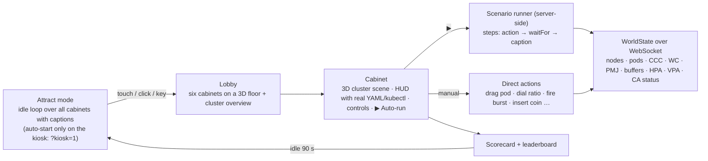

# Autoscale Arcade — Design

> Target: KubeCon + CloudNativeCon NA 2026, Salt Lake City. A pedestal with a landscape TV driven by a Chromebook (touch **and** mouse/keyboard), multiple presenters, hands-free ▶ runs, published for anyone to reproduce.

## 1. Goals and non-goals

**Goals**
- Show six GKE autoscaling capabilities on **one GKE Standard 1.37 (Rapid) cluster** with nothing simulated: every pixel is driven by real cluster objects.
- Be **visual first** (WebGL / Three.js spatial UI), **interactive** (drag, dial, tap), and **a bit game-like** (stopwatches, scores, leaderboard, attract mode).
- Be **operable by anyone at the booth**: a ▶ button per cabinet, an "Insert coin — play all" button, one-click reset, and the same scripts runnable from a terminal.
- Be **reproducible** from this repo with `make cluster && make deploy`.

**Non-goals**
- Production hardening of the arcade server (it is a demo controller with narrowly scoped RBAC behind IAP).
- Autopilot, multi-cluster, GPUs/TPUs.

## 2. Naming

- Demo and repo: **Autoscale Arcade** (`gke-demos/autoscale-arcade`).
- FQDN: `autoscale-arcade.demo.gke.ninja`.
- Cabinets: **Capacity Climber** (Compute Classes), **Spot On** (Workload Class spot ratio), **Pod Teleporter** (live Pod Migration), **Shock Absorber** (Capacity Buffers), **Lights Out** (scale to zero), **Nitro** (CPU startup boost).

## 3. Experience



### Shared 3D vocabulary
| Thing | Rendering | Driven by |
| :--- | :--- | :--- |
| Node | Glass slab on an island; colour by `cloud.google.com/machine-family`; diagonal stripe = `cloud.google.com/gke-spot`; dim + ❄ = `Suspended` condition (standby buffer); amber pulse while being created; red dissolve while cordoned/draining | Node labels, conditions, `spec.unschedulable`, CA status (`cloudProviderTarget` vs ready) |
| Island | Group of nodes; one island per ComputeClass priority rule / node pool | `cloud.google.com/gke-nodepool`, `compute-class` |
| Pod | Glowing cube on its node; colour by workload; halo = Pending; translucent ghost = buffer placeholder; flame = boosted; particle beam = snapshot/restore | Pod phase/conditions, `vpaCpuStartupBoost/*` annotation, PMJ phase |
| HUD | Right rail: the actual `kubectl get …` table / YAML for what is on screen; bottom bar: captions, stopwatch, cost meter | Same WorldState |
| Controls | Big touch targets (≥ 64 px), keyboard shortcuts (1–6 cabinets, space = ▶, R = reset, Esc = lobby) | |

Display: landscape 16:9, designed for 1080p and 4K TVs; UI scales with `vmin` units; WebGL at device pixel ratio ≤ 2 to keep the Chromebook GPU happy.

## 4. The six cabinets

### 4.1 Capacity Climber — Custom Compute Classes
- Objects: `ComputeClass/arcade-climber` with priorities `n4d spot → n4 spot → n4 on-demand`, `nodePoolAutoCreation.enabled: true` (NAP-less node pool auto-creation, GKE ≥ 1.33.3), `activeMigration.optimizeRulePriority: true`, `autoscalingPolicy: {consolidationDelayMinutes: 1, consolidationThreshold: 70}`, `whenUnsatisfiable: DoNotScaleUp` (explicit; default changed in 1.33). `Deployment/climber` (`nodeSelector: cloud.google.com/compute-class: arcade-climber`).
- Actions: **Scale 0 → 24** (auto-created pools appear as islands; pods fill the highest obtainable rung), **Lock rung #1** (patch priority 1 to `reservations.affinity: AnyThenFail` against a non-existent reservation → unobtainable → pods land on rung 2), **Unlock rung #1** (restore → active migration moves pods back up; old nodes drain and consolidate), **Scale → 0** (consolidation).
- Watch: node labels (`compute-class`, `machine-family`, `gke-spot`), CA status ConfigMap (`clusterWide.scaleUp.status`, per-node-group `cloudProviderTarget`), Pod events `TriggeredScaleUp` / `NotTriggerScaleUp`, `kubernetes.io/autoscaler/cluster_pending_pods_per_ccc` (1.37).

### 4.2 Spot On — Workload Class Spot placement and the On-Demand / Spot ratio
- Objects: `WorkloadClassGuardrail/default` (`enforcementMode: Allowed`, `minSpotRatio: "20%"`, `fallback.allowFallbackToOnDemand: true`, `fallback.maxFallbackRatio: "50%"`, `reversion.requiredReversionAction: Active`), `GKESpotPlacementPolicy/arcade-spot` (`customComputeClass: arcade-spot`, `reversion: {action: Active, minDurationOnFallback: 0s}`), `WorkloadClass/checkout` (`capacityStrategy: {type: Spot, spotRatio: "80%", action: FallbackToOnDemand}`, `infrastructureProfileRef → arcade-spot`), `Deployment/checkout` (10 replicas).
- `ComputeClass/arcade-spot`: `n4d spot`, `n4 spot`, `n4 on-demand`, NPAC enabled. The plugin injects Spot / On-Demand affinity per pod to hit the ratio.
- Actions: **Ratio dial 0–100 %** (patches `spotRatio`; pods re-colour as the ratio is realised; live $/h meter), **Preempt a Spot node** (`gcloud compute instances simulate-maintenance-event` → a real Spot preemption; pods reschedule), **Stockout** (drain Spot nodes + hold Spot capacity at 0 via a `CapacityQuota`/pool cap → pods fall back, `InFallback=True`), **Capacity returns** (lift the cap → *Active reversion* evicts fallback pods oldest-first back onto Spot).
- Watch: `kubectl get workloadclass` (`CAPACITY`, `SPOTRATIO`, `VALIDATED`), `InFallback` condition, per-pod `nodeSelector`/affinity injected by the webhook, `FallbackBudgetExhausted` events.
- Open validation item (day 1 on the real cluster): the cheapest deterministic "stockout" lever — `CapacityQuota` for the Spot class vs. temporarily removing the Spot rules from the ComputeClass vs. capping the auto-created pool.

### 4.3 Pod Teleporter — live Pod Migration (headline)
- Platform: `--enable-pod-snapshots`, Workload Identity, GCS bucket (same region, HNS, UBLA, soft-delete off), fixed **3-node gVisor pool** (`n4-standard-4`, autoscaling off — whole-pod snapshots need identical machine series/CPU platform and no E2), cert-manager, `pod-migration` controller + `PodMigration` config.
- Workload: `StatefulSet/pet` (1 replica, `runtimeClassName: gvisor`, label `pod-migration.gke.io/enabled: "true"`, **`updateStrategy.type: OnDelete`**). The pet is a tiny Go process holding **only in-memory** state: a tick counter, a score, a 2D bouncing-ball simulation, and a log of "lives" (migrations survived). It streams its state over WebSocket to the arcade server, which relays it to the UI.
- Drag-and-drop → migration: UI drops the pod on node *X* → server `PATCH`es the StatefulSet template `nodeSelector: {kubernetes.io/hostname: X}` (no rollout, because `OnDelete`) → server calls the **Eviction API** on `pet-0` → the pod-migration webhook answers 429 and creates a `PodMigrationJob` → the UI animates `Snapshotting → Evicting → Restoring → Succeeded` as a particle beam from the old node to *X*; the pet's counter freezes, then **resumes from the same value** on *X*; the stopwatch records downtime and posts it to the leaderboard.
- Watch: `PodMigrationJob.status.phase` and `*StartTime` fields, `PodSnapshot` `Ready`, event `GKEPodSnapshotting`, the `Restored` condition (`RestoreVerified` / `RestoreInferred`), pet state continuity.
- Fallbacks: "Random teleport" button (drain current node), and if restore degrades to `SucceededWithoutRestore` the UI says so honestly ("cold start — lost N ticks").

### 4.4 Shock Absorber — Capacity Buffers
- Objects: `PodTemplate/burst-unit` (same shape as the burst worker), `CapacityBuffer/absorber-active` (`provisioningStrategy: buffer.x-k8s.io/active-capacity`, `replicas: N`), `CapacityBuffer/absorber-standby` (`buffer.gke.io/standby-capacity`, nodes suspended after `buffer.gke.io/standby-capacity-init-time`), `Deployment/burst-worker` (0 → +12 on burst). Buffer nodes are fenced for the burst worker with a dedicated ComputeClass taint/toleration so other pods do not steal the headroom.
- Game: choose a buffer preset (none / active 4 / active 8 / standby 8) → **Fire burst** → stopwatch to all-Ready → score = time vs. headroom $/h. Ghost pods visualise reserved headroom; new pods snap into ghosts instantly versus waiting for amber nodes; standby nodes show the ❄ → resume transition.
- Watch: `CapacityBuffer.status.replicas` and `conditions[Ready | ReadyForProvisioning | LimitedByQuotas]`, Node `Suspended` condition, per-pod `PodScheduled → Ready` latency computed from pod timestamps, `kubernetes.io/pod/latencies/pod_first_ready`.

### 4.5 Lights Out — scale to zero
- Objects: `Deployment/coin-worker` (ships at 1 replica; the HPA takes it to 0 — an HPA created against a target already at 0 is `ScalingDisabled`), `autoscaling/v2 HorizontalPodAutoscaler` with **`minReplicas: 0`** (K8s 1.37 HPAScaleToZero beta; GKE 1.37 control plane **and** nodes), `ClusterPodMonitoring/arcade-server` (Managed Prometheus scrapes `arcade_queue_depth` from the arcade server's `/metrics` every 10 s), `AutoscalingMetric/coin-queue` (`autoscaling.gke.io/v1beta1`) with the **`promql:` source** `max(arcade_queue_depth{namespace="arcade-system"})`; HPA `External` metric `autoscaling.gke.io|coin-queue|arcade_queue_depth`, `target.averageValue: 2`, `behavior.scaleDown.stabilizationWindowSeconds: 60` for a booth-friendly cycle.
- Why not the in-cluster `pod:` source (ADR 0004 amendment): it yields a `Pods`-type metric, which the API server rejects for `minReplicas: 0` and which cannot be computed with zero pods. The Managed Prometheus path adds ~30–60 s but is the only GKE-native way to wake from zero on an application gauge. The Pub/Sub variant is documented as the production pattern.
- Actions: **Insert coin** (+1 job), **Slam** (+50) → `ScaledToZero: False`, pods light up; workers drain the queue; idle → `ScaledToZero: True`, lights go out.
- Watch: HPA conditions (`ScaledToZero`, `ScalingActive` stays True at 0), `currentMetrics`, `SuccessfulRescale` events, Deployment replicas.

### 4.6 Nitro — CPU startup boost
- Objects: `Deployment/stock` and `Deployment/nitro` (identical: 250m CPU, a CPU-bound warm-up before readiness), `VerticalPodAutoscaler/nitro` with `updatePolicy.updateMode: InPlaceOrRecreate` and `startupBoost.cpu: {type: Factor, factor: 4, durationSeconds: 0}`.
- Action: **Start race** → rollout-restart both → two lanes, flame on the boosted pod, finish line = `Ready=True`; afterwards the HUD shows the in-place **unboost** (`InPlaceResizedByVPA`, `RESTARTS: 0`, `spec` vs `status.containerStatuses[].resources`).
- Watch: `vpaCpuStartupBoost/<container>` annotation, events `InPlaceResizedByVPA` / `ResizeCompleted`, readiness timestamps.

## 5. Architecture

### Components (one container image, `ghcr.io/gke-demos/autoscale-arcade`)
- `arcade-server` (Go): client-go informers (Nodes, Pods, Events, Deployments, StatefulSets, HPA, VPA, ComputeClass, CapacityBuffer, WorkloadClass, GKESpotPlacementPolicy, PodMigrationJob, PodSnapshot, CA status ConfigMap) → normalised **WorldState** diffs over WebSocket; REST **actions** (scale, patch ratio, evict/migrate, cordon/drain, pool cap, simulate preemption, enqueue coins, race); **scenario runner** for `scenarios/*.yaml`; `/metrics`; serves the embedded UI (`go:embed`).
- `pet` (Go): the migratable in-memory game process.
- `worker` (Go): `coin-worker` (drains the queue), `burst-worker` (sleeps-then-ready with configurable warm-up), `stock`/`nitro` (CPU-bound warm-up).
- `web/` (Vite + React + TypeScript + React Three Fiber/drei + zustand + Tailwind): scenes, HUD, attract mode, leaderboard.

### Scenario runner
```yaml
# scenarios/pod-teleporter.yaml
name: Pod Teleporter
steps:
  - caption: "Meet the pet — all of its state lives in memory on this node."
    action: {type: wait, seconds: 5}
  - caption: "Teleporting to another node… snapshot → evict → restore"
    action: {type: migrate, pod: pet-0, namespace: arcade-teleporter, toNode: "{{ randomOtherGvisorNode }}"}
    waitFor: {kind: PodMigrationJob, jsonpath: "{.status.phase}", equals: Succeeded, timeout: 180s}
  - caption: "Same counter, new node. {{ downtimeSeconds }}s of downtime."
```
The same files back the browser ▶ buttons, "play all", attract mode and `make play-<cabinet>`.

### Access: Gateway + IAP
- `Gateway/arcade` (`gke-l7-global-external-managed`, HTTPS :443, annotation `networking.gke.io/certmap: star-demo-gke-ninja`), `HTTPRoute` for `autoscale-arcade.demo.gke.ninja`, `GCPBackendPolicy` with `iap.enabled: true` and a 3600 s `timeoutSec` for WebSockets, `HealthCheckPolicy` on `/healthz`.
- IAP allow-list: the presenters' Google accounts (IAP-secured Web App User). The kiosk Chromebook signs in once; the IAP session cookie covers the WebSocket upgrade.
- DNS: `A` record in the `demo.gke.ninja` zone pointing at the Gateway's static global IP.
- **Project caveat:** the `star-demo-gke-ninja` certificate map and the `demo.gke.ninja` zone live in `gke-demos-345619`; Certificate Manager maps are project-scoped, so `kcna-2026-demos` needs its own map (DNS-authorised wildcard or a per-host managed cert). Tracked in the issues.
- Defence in depth: the action API additionally checks the IAP JWT (`x-goog-iap-jwt-assertion`) audience, and all mutating endpoints are rate-limited.

### RBAC
Dedicated `ServiceAccount/arcade-server` with: read on everything it watches; write on Deployments/StatefulSets/HPAs/WorkloadClasses/ComputeClasses/CapacityBuffers in the arcade namespaces; `pods/eviction` create; nodes patch (cordon); Workload Identity binding with `roles/compute.instanceAdmin.v1` scoped by condition to the demo cluster's instances (for `simulate-maintenance-event`) and `roles/container.clusterViewer`.

## 6. Cluster

```sh
gcloud container clusters create autoscale-arcade --location "$REGION" \
  --release-channel rapid --cluster-version 1.37.1-gke.1697000 \
  --machine-type n4-standard-4 --num-nodes 1 \
  --enable-pod-snapshots --workload-pool "$PROJECT_ID.svc.id.goog" --workload-metadata GKE_METADATA \
  --enable-vertical-pod-autoscaling --autoscaling-profile optimize-utilization \
  --gateway-api standard --enable-ip-alias \
  --logging SYSTEM,WORKLOAD,KCP_VPA --monitoring SYSTEM,HPA,CADVISOR,KUBELET
gcloud container node-pools create gvisor --cluster autoscale-arcade --location "$REGION" \
  --sandbox type=gvisor --machine-type n4-standard-4 --image-type cos_containerd --num-nodes 1   # 3 nodes across zones; or --node-locations one zone, 3 nodes
```
Then: GCS bucket + IAM, cert-manager, `workload-class` (`dist/install.yaml`), `pod-migration` controller, ComputeClasses. All Spot/On-Demand/buffer capacity comes from node pool auto-creation.

Cost guard: `make reset` scales every cabinet to zero; CCC consolidation at 1 min; `make teardown` deletes the cluster.

## 7. Repository layout
See `README.md`. Manifests are kustomize bases per cabinet (`manifests/0N-<cabinet>/`), namespaces `arcade-system` and `arcade-<cabinet>`.

## 8. Build plan

| When | Milestone |
| :--- | :--- |
| Sun 2 Nov | Design approved; repo + docs + issues; scaffolding (Go module, web app, Makefile, CI) |
| Mon 3 | Cluster bootstrap script validated in a scratch project; arcade-server WorldState over WS; base 3D scene with real nodes/pods |
| Tue 4 | Pod Teleporter and Spot On end-to-end (highest risk) |
| Wed 5 | Capacity Climber, Shock Absorber, Lights Out, Nitro; scenario runner; ▶ buttons |
| Thu 6 | Attract mode, leaderboard, HUD polish, kiosk fullscreen/touch, Gateway + IAP in `kcna-2026-demos`, docs, `make verify-*` |
| Fri 7 | Rehearsal with presenters, reset drills, fallback MP4 recording |

Cut order if time is short: standby buffers → Capacity Climber lock/unlock → leaderboard.

## 9. Risks
| Risk | Mitigation |
| :--- | :--- |
| `kcna-2026-demos` not ready | Build against a scratch cluster in `gke-demos-345619`; everything is parameterised by `PROJECT_ID`. |
| Pod Snapshots restore flakiness | Small pet image, no volumes, `postCheckpoint: stop` via controller; "random teleport" fallback; honest cold-start messaging. |
| Spot capacity in the venue week | n4d/n4 Spot in `us-central1` plus on-demand rung; stockout is a deliberate lever anyway. |
| NPAC pool creation latency (60–120 s) | Pre-warm with `minimumCapacity`/small buffers before a run; attract mode keeps pools warm. |
| Booth network / IAP login friction | Chromebook signs in once; `kubectl port-forward` documented as the fallback path. |
| Conference-week quota limits | Request CPU + IP quota early in `kcna-2026-demos`; `make preflight` checks. |
